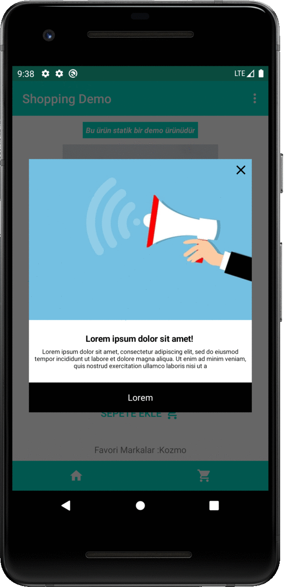
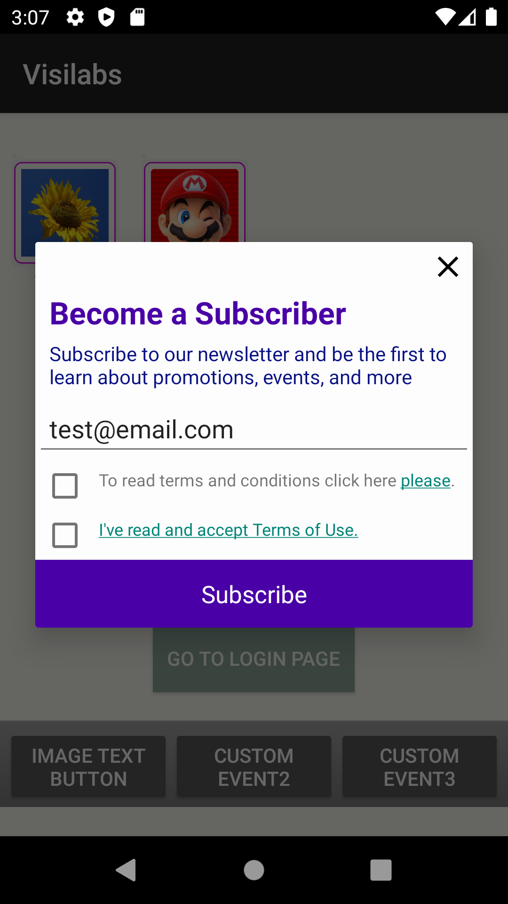
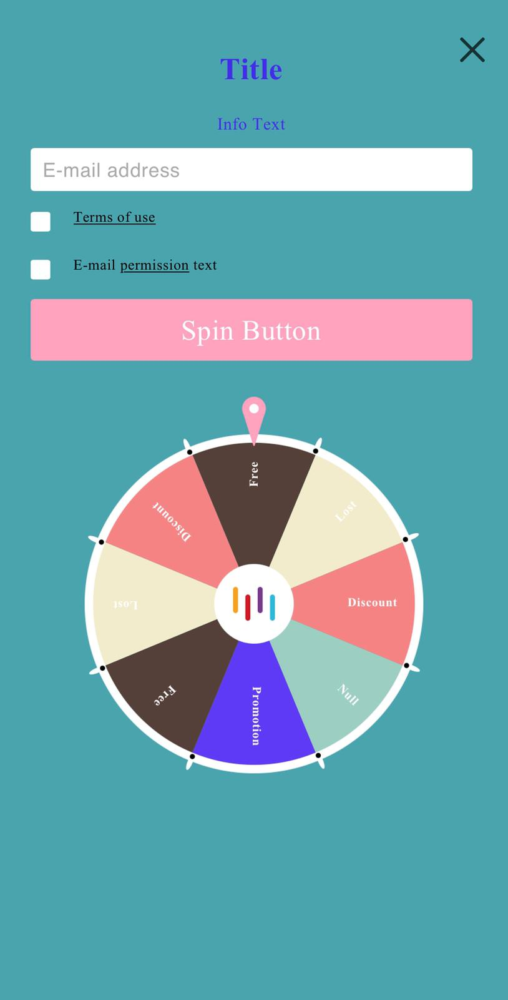
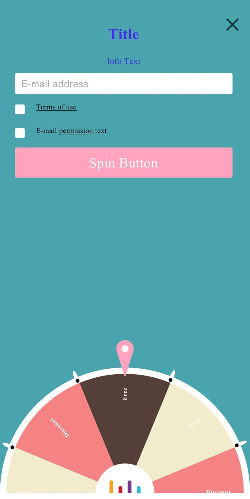

<p align="center">
  <a target="_blank" rel="noopener noreferrer" href="https://github.com/relateddigital/visilabs-android"></a>
</p>

# Latest Version 

***March 3, 2025*** - [Visilabs v6.4.8](https://github.com/relateddigital/visilabs-android/releases)

# Latest Version [](https://travis-ci.com/relateddigital/visilabs-android)

# Table of Contents

- [Latest Version](#latest-version)
- [Visilabs Android](#visilabs-android)
  * [Installation](#installation)
    + [Sample Applications](#sample-applications)
    + [Using the SDK](#using-the-sdk)
    + [Licence](#licence)
  * [Mail Subscription Form](#mail-subscription-form)
  * [Sending Campaign Parameters](#sending-campaign-parameters)
    
# Visilabs Android

The Visilabs Android Sdk is a java implementation of an Android client for Visilabs.

## Installation

Visilabs Android SDK requires minimum API level 21.

Add maven jitpack repository to your project/build.gradle file

	allprojects {
		repositories {
			...
			maven { url 'https://jitpack.io' }
		}
	}

Add Visilabs to the ```dependencies``` in app/build.gradle.

```java
implementation 'com.github.relateddigital:visilabs-android:6.7.9'
```
This version uses AndroidX

### Visilabs SDK Set Up

Mobile Tagging for Visilab and more information :  [Please check docs](https://relateddigital.atlassian.net/wiki/spaces/RMCKBT/pages/428802408/Android+-+API+Setup) 

#### Initializing off the main thread

`Visilabs.CreateAPI(...)` and `EuroMobileManager.init(...)` read SharedPreferences and set up network clients, Google Play Services and geofencing. When they run in `Application.onCreate()` on the main thread, the process can hit an ANR, especially when it is started in the background by a push, a geofence alarm or a geofence transition. Call them on a background thread instead:

```java
@Override
public void onCreate() {
    super.onCreate();
    new Thread(this::initRelatedDigital, "related-digital-init").start();
}
```

`Visilabs.CallAPI()` is synchronized with `CreateAPI(...)`, so a call made while initialization is still running waits for it to finish. A call made before initialization starts returns `null`; check for `null` before using it. Since 6.7.9, the geofence alarm receiver and the geofence transition service also do their initialization off the main thread.

        
        
### Sample Applications 

- [Visilabs Sample Application **NEW REPO ](https://github.com/relateddigital/sample_visilabs_android) 

#### Note : 
You may use the support library module in sample application but we will not contribute support library in the future. This is our last support.


|              In App Notification              | Story                                                            |
|:----------------------------------------------------------------:|----------------------------------------------------------------------------|
|                  |                           |


## Mail Subscription Form

After form is created at **RMC** panel, likewise **in-app message**, existence of mail subscription form is controlled by after each `customEvent` call.
You need to call overload of `customEvent` which takes `Activity` as third parameter in order to show mail subscription forms.

```java
customEvent(String pageName, HashMap<String, String> properties, Activity parent)
```

It is shown as follows;



## Spin To Win

After form is created at **RMC** panel, likewise **in-app message**, existence of spin to win is controlled by after each `customEvent` call.
You need to call overload of `customEvent` which takes `Activity` as third parameter in order to show spin to win.

```java
customEvent(String pageName, HashMap<String, String> properties, Activity parent)
```

It is shown as follows;

|               Spin to Win Full                                   |                        Spin to Win Half                                    |
|:----------------------------------------------------------------:|----------------------------------------------------------------------------|
|           |                     |


## Sending Campaign Parameters

You can send campaign parameters using `sendCampaignParameters` :

```java
HashMap<String, String> properties = new HashMap<>();
properties.put("utm_campaign","euromsg campaign");
properties.put("utm_source","euromsg");
properties.put("utm_medium","push");
Visilabs.CallAPI().sendCampaignParameters(properties);
```

### Licences


 - [Related Digital ](https://www.relateddigital.com/)
 - [Visilabs ](http://visilabs.com/)
